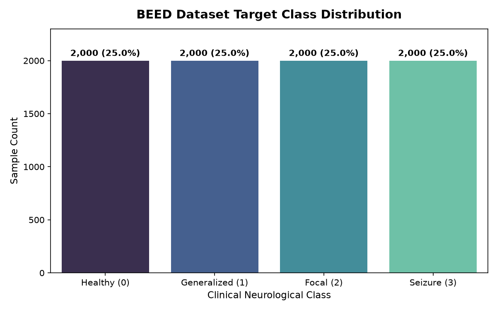
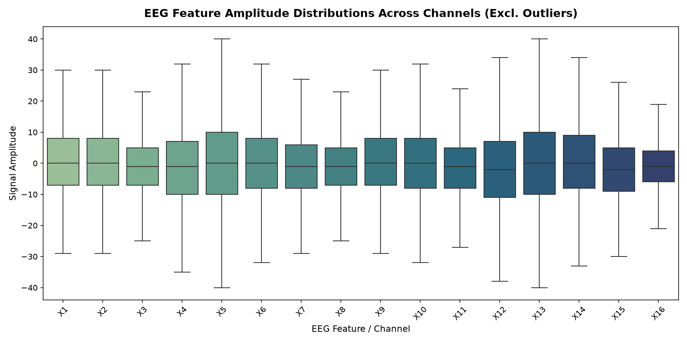
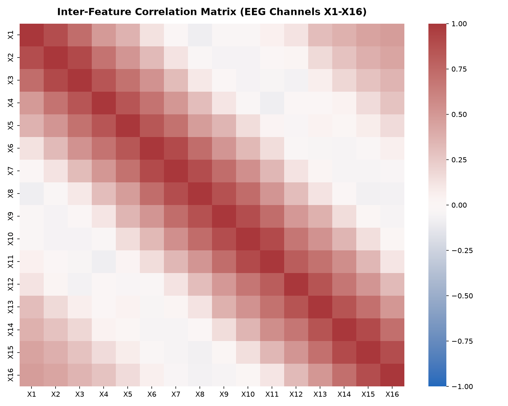
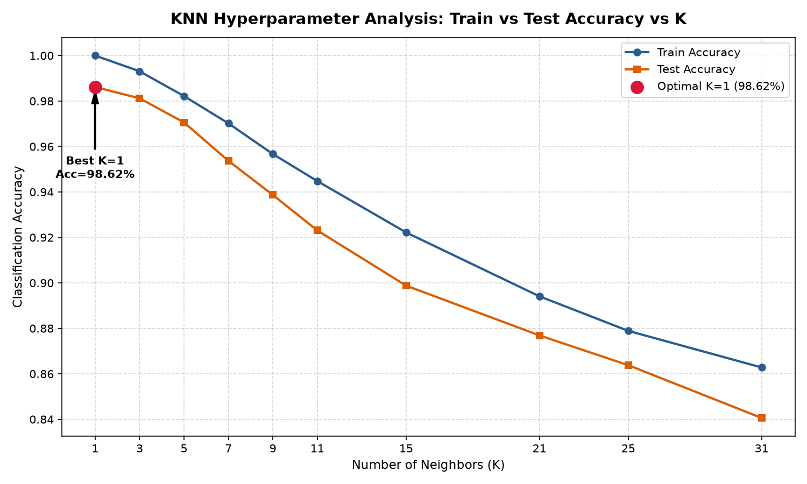
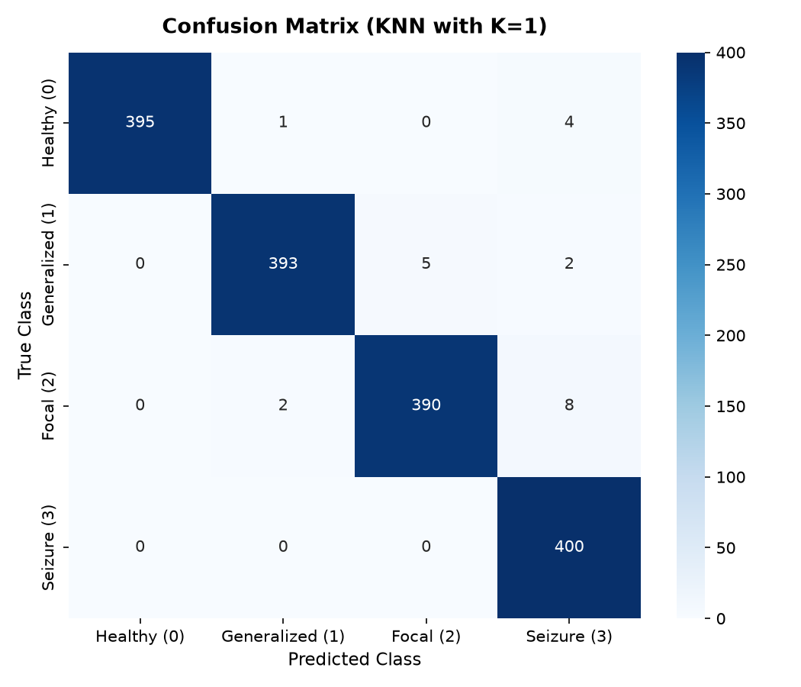
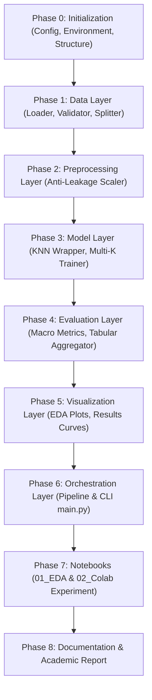

# KNN Classification on BEED: Hyperparameter ($K$) Comparison

[](https://www.python.org/downloads/)
[](https://github.com/bugkey24/knn-beed-k-comparison)
[](https://colab.research.google.com/github/bugkey24/knn-beed-k-comparison/blob/main/notebooks/02_knn_experiment.ipynb)
[](https://archive.ics.uci.edu/dataset/1134/beed:+bangalore+eeg+epilepsy+dataset)
[](https://www.kaggle.com/datasets/varunrajput/beed-bangalore-eeg-epilepsy-dataset)
[](#system-architecture)
[](#testing)
[](#key-highlights--performance)
[](LICENSE)

An end-to-end, production-grade machine learning project implementing, evaluating, and visualizing **K-Nearest Neighbors (KNN)** across hyperparameter neighborhood values $K \in [1, 3, 5, 7, 9, 11, 15, 21, 25, 31]$ on the **Bangalore EEG Epilepsy Dataset (BEED)**.

Developed for the **Decision Support Systems (Sistem Pendukung Keputusan / SPK)** practicum, prioritizing methodological rigor, clean architecture, anti-data leakage guards, and comprehensive visual analytics.


---

## Table of Contents
1. [Key Highlights & Performance](#key-highlights--performance)
2. [Dataset Overview & Visualizations](#dataset-overview--visualizations)
3. [Empirical Results & Hyperparameter Trajectory](#empirical-results--hyperparameter-trajectory)
4. [Project Stages & Implementation Roadmap](#project-stages--implementation-roadmap)
5. [System Architecture](#system-architecture)
6. [How to Run the Project](#how-to-run-the-project)
   - [Local Execution (CLI & Script)](#1-local-execution-cli)
   - [Google Colab Execution](#2-google-colab-execution)
7. [Testing](#testing)
8. [Documentation Index](#documentation-index)

---

## Key Highlights & Performance

- **Optimal Hyperparameter**: **$K=1$** achieves **98.62% Test Accuracy** and **0.9863 Macro F1-score**, closely followed by **$K=3$ (98.12%)**.
- **Clinical Decision Support Safety**: Achieves **100.0% Recall (400/400)** for active seizure events (Class 3), producing zero critical false negatives.
- **Anti-Data Leakage Protocol**: Standard scalers fit strictly on the 80% training partition; test samples remain completely unseen until inference.
- **Dual Runtime Support**: Fully executable via local CLI (`python main.py`) and reproducible on Google Colab with dedicated interactive notebooks.
- **Automated Verification**: 100% passing test suite across 12 unit and integration tests.

---

## Dataset Overview & Visualizations

The **BEED (Bangalore EEG Epilepsy Dataset)** is available publicly from the following repositories:
- **UCI Machine Learning Repository**: [BEED: Bangalore EEG Epilepsy Dataset (UCI #1134)](https://archive.ics.uci.edu/dataset/1134/beed:+bangalore+eeg+epilepsy+dataset)
- **Kaggle**: [Varun Rajput's BEED Dataset Mirror](https://www.kaggle.com/datasets/varunrajput/beed-bangalore-eeg-epilepsy-dataset)

The dataset consists of 8,000 instances with 16 continuous numeric EEG signal attributes (`X1`–`X16`) and a balanced 4-class target label `y`.

### Target Class Distribution
The dataset is perfectly balanced with exactly 2,000 samples (25.0%) per clinical state, eliminating majority-class voting bias:
- **Class 0**: Healthy baseline
- **Class 1**: Generalized seizure
- **Class 2**: Focal seizure
- **Class 3**: Seizure event / ictal discharge



### Feature Distributions & Correlation Matrix
Signal amplitudes fluctuate across discrete measurement channels, necessitating Z-score standardization ($z = \frac{x - \mu}{\sigma}$).

| Feature Amplitude Spread | Inter-Channel Correlation Matrix |
|:---:|:---:|
|  |  |

---

## Empirical Results & Hyperparameter Trajectory

On the 20% stratified test partition (1,600 held-out samples, 400 per class):

| $K$ | Train Accuracy | Test Accuracy | Macro Precision | Macro Recall | Macro F1 | Inference Latency (ms) |
|:---:|:---:|:---:|:---:|:---:|:---:|:---:|
| **1** | **1.0000** | **0.9862** | **0.9865** | **0.9863** | **0.9863** | 94.98 |
| **3** | 0.9931 | 0.9812 | 0.9818 | 0.9813 | 0.9813 | 19.91 |
| **5** | 0.9822 | 0.9706 | 0.9713 | 0.9706 | 0.9707 | 18.42 |
| **7** | 0.9702 | 0.9537 | 0.9554 | 0.9537 | 0.9539 | 18.21 |
| **9** | 0.9567 | 0.9387 | 0.9411 | 0.9387 | 0.9390 | 21.49 |
| **11** | 0.9448 | 0.9231 | 0.9270 | 0.9231 | 0.9236 | 23.08 |
| **15** | 0.9222 | 0.8988 | 0.9060 | 0.8987 | 0.8993 | 22.67 |
| **21** | 0.8941 | 0.8769 | 0.8879 | 0.8769 | 0.8774 | 23.50 |
| **25** | 0.8789 | 0.8638 | 0.8767 | 0.8638 | 0.8639 | 27.22 |
| **31** | 0.8628 | 0.8406 | 0.8584 | 0.8406 | 0.8406 | 33.41 |

### Accuracy vs. $K$ & Optimal Confusion Matrix

| Accuracy vs. Number of Neighbors ($K$) | Confusion Matrix for Optimal $K=1$ |
|:---:|:---:|
|  |  |

- **Bias-Variance Insight**: Small $K$ ($K=1, 3$) captures fine-grained signal patterns in high-density space. As $K \ge 5$, accuracy decays monotonically to 84.06% ($K=31$) due to boundary oversmoothing across class margins.
- **Error Decomposition**: Class 3 (Seizure Event) is detected with 100% recall. The only minor confusion occurs between Generalized (Class 1) and Focal (Class 2) seizures due to shared electrophysiological traits.

---

## Project Stages & Implementation Roadmap

The project was executed through an 8-phase clean architecture lifecycle:



All 6 quality gates (data validation, anti-leakage scaling, hyperparameter grid evaluation, visual artifact export, 12/12 unit tests passing, and dual runtime verification) were successfully met.

---

## System Architecture

The codebase enforces strict separation of concerns and unidirectional dependencies:

```
knn-beed-k-comparison/
├── config/
│   └── config.yaml             # Central configuration (paths, seed, K grid)
├── beed-bangalore-eeg-epilepsy-dataset/
│   └── BEED_Data.csv           # Raw dataset
├── src/
│   ├── config.py               # YAML configuration schema dataclass
│   ├── data/                   # Ingestion, schema validator, stratified splitter
│   ├── preprocessing/          # Anti-leakage StandardScaler wrapper
│   ├── models/                 # KNN classifier and trainer iterator
│   ├── evaluation/             # Multi-class macro metrics & results aggregator
│   ├── visualization/          # EDA and performance plotting routines
│   ├── pipeline.py             # Full programmatic pipeline orchestrator
│   └── utils/                  # Structured logger and file I/O helpers
├── notebooks/
│   ├── 01_exploration.ipynb    # Interactive EDA notebook
│   └── 02_knn_experiment.ipynb # Colab-ready experiment notebook
├── tests/                      # 12 automated unit and integration tests
├── outputs/                    # Figures, results CSV, pickled models, and logs
└── docs/                       # Comprehensive modular documentation
```

---

## How to Run the Project

### 1. Local Execution (CLI)

#### Prerequisites
- Python 3.10 or higher.

#### Setup & Run
```bash
# 1. Clone repository and navigate to the project directory
git clone https://github.com/bugkey24/knn-beed-k-comparison.git
cd knn-beed-k-comparison

# 2. Install dependencies
pip install -r requirements.txt

# 3. Execute the full end-to-end pipeline via CLI
python main.py

# Optional: Specify a custom configuration file
python main.py --config config/config.yaml
```

The CLI will log the step-by-step progress, output the comparative table in stdout, and save all figures, models, and CSV files in `outputs/`.

---

### 2. Google Colab Execution

You can run the entire workflow in the cloud without local setup using Google Colab:

[](https://colab.research.google.com/github/bugkey24/knn-beed-k-comparison/blob/main/notebooks/02_knn_experiment.ipynb)

1. Open the notebook directly via the badge above, or open [colab.research.google.com](https://colab.research.google.com) and import `notebooks/02_knn_experiment.ipynb`.
2. In the first cell of the notebook, execute the setup command:
   ```python
   # Mount Google Drive or clone the repo
   !git clone https://github.com/bugkey24/knn-beed-k-comparison.git
   %cd knn-beed-k-comparison
   !pip install -r requirements.txt
   ```
4. Run all cells (`Runtime` -> `Run all`). The pipeline will execute, display the performance metrics, and render the `Accuracy vs K` and `Confusion Matrix` charts inline.

For exploratory data analysis, you can also run `notebooks/01_exploration.ipynb` in Colab.

---

## Testing

Execute the test suite using `pytest`:

```bash
python -m pytest tests/ -v
```

All 12 unit and integration tests verify:
- Dataset loading and missing values rejection.
- Stratified partitioning ratio and balance preservation.
- Feature scaler anti-leakage isolation (test data does not modify fitted parameters).
- Model prediction dimensions and metric calculations against scikit-learn ground truth.
- End-to-end pipeline execution and output artifact generation.

---

## Documentation Index

| Document | Purpose |
|---|---|
| [REPORT.md](docs/REPORT.md) | Complete academic report with clinical and bias-variance analysis |
| [ARCHITECTURE.md](docs/ARCHITECTURE.md) | Architectural layout, layer contracts, and sequence diagrams |
| [ROADMAP.md](docs/ROADMAP.md) | Phase milestone tracking and quality gates checklist |
| [METHODOLOGY.md](docs/METHODOLOGY.md) | Mathematical formulation, distance metrics, and $K$ mechanics |
| [DATA_DICTIONARY.md](docs/DATA_DICTIONARY.md) | Attribute definitions, EEG signal characteristics, and class taxonomy |
| [EXPERIMENTS.md](docs/EXPERIMENTS.md) | Experiment protocols, benchmark standards, and reporting rules |
| [EXP_001_k_comparison.md](docs/experiments/EXP_001_k_comparison.md) | Formal experiment log for the baseline $K$ hyperparameter evaluation |
| [CHANGELOG.md](CHANGELOG.md) | Release history following Keep a Changelog |
