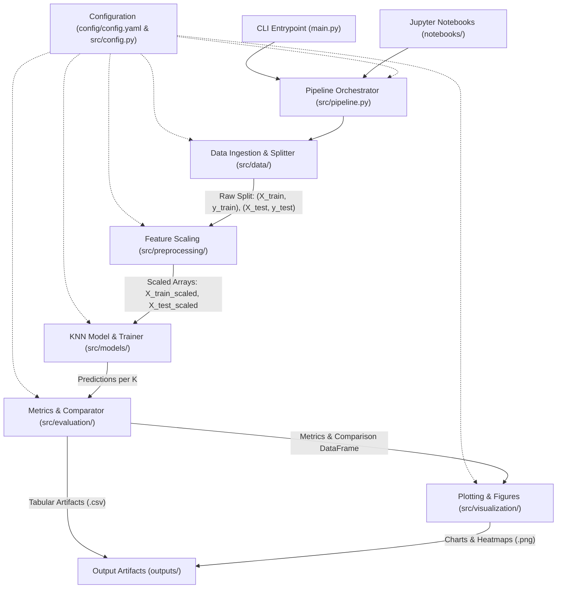
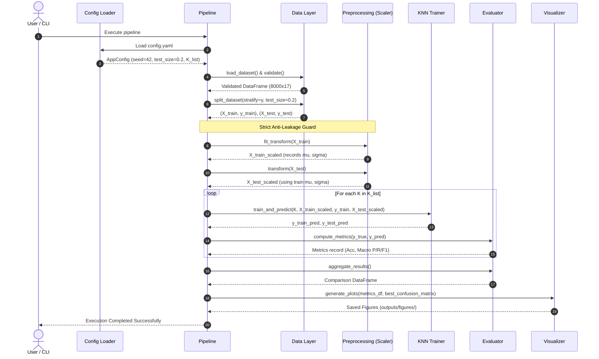

# System Architecture & Technical Specifications

> **Scope**: Structural design, component dependencies, interfaces, and layer contracts for the BEED KNN Classification project.  
> **Standard**: Clean Architecture, Single Responsibility, Config-driven execution.

---

## 1. Architectural Overview & Component Dependencies

The system strictly decouples the domain workflow across horizontal layers. Communication flows unidirectionally from the entry point (`main.py` or interactive notebooks) down through the orchestration pipeline, modular components, and foundational utilities.



---

## 2. Directory Layout & Layer Responsibilities

```
knn-beed-k-comparison/
├── config/
│   └── config.yaml             # Single source of truth for runtime parameters
├── data/
│   └── beed-bangalore-eeg-epilepsy-dataset/   # Read-only dataset store
│       └── BEED_Data.csv
├── src/
│   ├── config.py               # YAML configuration schema (dataclasses/Pydantic)
│   ├── data/
│   │   ├── loader.py           # Ingestion from CSV to pd.DataFrame
│   │   ├── validator.py        # Schema checks, nulls, type assertions, balance checks
│   │   └── splitter.py         # Stratified train/test splitting
│   ├── preprocessing/
│   │   └── scaler.py           # StandardScaler wrapper ensuring zero data leakage
│   ├── models/
│   │   ├── knn.py              # KNN estimator encapsulation
│   │   └── trainer.py          # Multi-K evaluation iterator
│   ├── evaluation/
│   │   ├── metrics.py          # Multi-class metrics (accuracy, macro P/R/F1, conf mat)
│   │   └── comparator.py       # Metrics aggregation across hyperparameter grid
│   ├── visualization/
│   │   ├── eda.py              # Distribution plots, correlation matrix, balance charts
│   │   └── results.py          # Accuracy vs K, confusion matrix heatmaps
│   ├── pipeline.py             # Full execution pipeline callable as a function
│   └── utils/
│       ├── logger.py           # Structured formatting logger
│       └── io.py               # Artifact serializers (CSV, JSON, Pickle, Figure export)
├── notebooks/                  # Colab-ready Jupyter notebooks
│   ├── 01_exploration.ipynb
│   └── 02_knn_experiment.ipynb
├── tests/                      # Pytest suite
│   ├── test_loader.py
│   ├── test_splitter.py
│   ├── test_scaler.py
│   ├── test_metrics.py
│   └── test_pipeline.py
├── outputs/                    # Runtime artifacts generated during execution
│   ├── figures/
│   ├── results/
│   ├── models/
│   └── logs/
└── docs/                       # Project documentation
    ├── ARCHITECTURE.md
    ├── METHODOLOGY.md
    ├── DATA_DICTIONARY.md
    ├── EXPERIMENTS.md
    ├── REPORT.md
    └── experiments/
        └── TEMPLATE.md
```

---

## 3. Data Pipeline Sequence

The detailed runtime sequence diagram illustrates the lifecycle of data and the enforcement of the anti-leakage policy:



---

## 4. Layer Contracts & Interfaces

### 4.1 Config Layer (`src/config.py`)
- **Input**: YAML file path (`config/config.yaml`).
- **Output**: Immutable typed data structure (`AppConfig`).
- **Rule**: No magic numbers or hardcoded parameters in downstream modules.

### 4.2 Data Layer (`src/data/`)
- `loader.load_beed_dataset(path: Path) -> pd.DataFrame`
- `validator.validate_beed_dataset(df: pd.DataFrame) -> bool`
  - Validates exact 17 columns (`X1` to `X16`, `y`).
  - Ensures exactly 8,000 rows with 0 missing values.
  - Asserts four classes with equal frequency (2,000 per class).
- `splitter.split_dataset(df: pd.DataFrame, test_size: float, random_state: int) -> Tuple[np.ndarray, np.ndarray, np.ndarray, np.ndarray]`
  - Performs stratified splitting (`stratify=y`).

### 4.3 Preprocessing Layer (`src/preprocessing/scaler.py`)
- Standardizes feature scales ($z = (x - \mu) / \sigma$).
- **Anti-Leakage Guard**:
  - `fit_transform(X_train: np.ndarray) -> np.ndarray` (computes $\mu, \sigma$ from train only).
  - `transform(X_test: np.ndarray) -> np.ndarray` (applies precomputed $\mu, \sigma$ to test).
  - Test set data must **never** be seen during `fit`.

### 4.4 Model & Evaluation Layer (`src/models/`, `src/evaluation/`)
- Runs multi-class KNN classification over configured $K \in [1, 3, 5, 7, 9, 11, 15, 21, \dots]$.
- Computes:
  - Accuracy
  - Macro Precision, Macro Recall, Macro F1-score
  - Multiclass Confusion Matrix
- Aggregates comparative performance in tabular format (`k_comparison.csv`).

### 4.5 Visualization Layer (`src/visualization/`)
- All plotting routines accept pure data structures, output path, and DPI settings.
- Must return `matplotlib.figure.Figure` object and gracefully save to disk.
- Non-interactive rendering backend (`Agg`) used for headless CLI execution.
