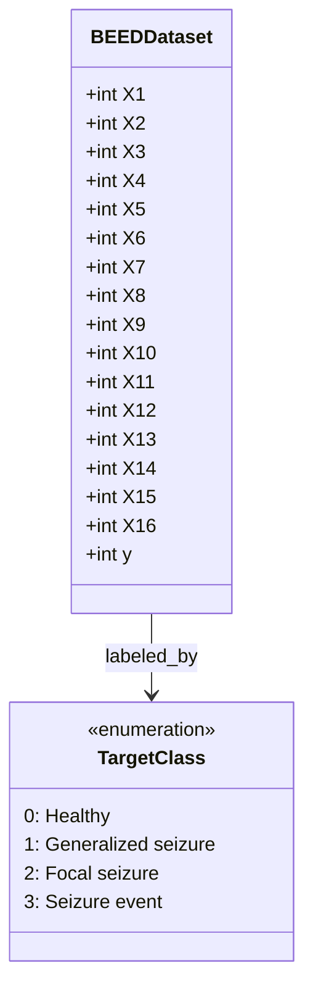

# BEED Dataset: Data Dictionary & Characteristics

> **Dataset Name**: BEED (Bangalore EEG Epilepsy Dataset)  
> **Official Sources**:
> - UCI Machine Learning Repository: [BEED: Bangalore EEG Epilepsy Dataset (#1134)](https://archive.ics.uci.edu/dataset/1134/beed:+bangalore+eeg+epilepsy+dataset)  
> - Kaggle: [BEED: Bangalore EEG Epilepsy Dataset (Varun Rajput)](https://www.kaggle.com/datasets/varunrajput/beed-bangalore-eeg-epilepsy-dataset)  
> **Local Reference**: `beed-bangalore-eeg-epilepsy-dataset/BEED_Data.csv`  
> **File Size**: ~404 KB  

---

## 1. Summary Statistics

| Characteristic | Specification |
|---|---|
| **Total Instances (Rows)** | 8,000 |
| **Total Features (Columns)** | 16 Continuous Numeric Predictors + 1 Target Label |
| **Data Types** | Integer (int64) |
| **Missing Values** | 0 (No imputation required) |
| **Class Distribution** | Perfectly Balanced (25% per class, 2,000 samples each) |

---

## 2. Dataset Entity & Feature Schema

---

## 3. Feature Definitions

The features represent sampled electroencephalogram (EEG) signal amplitudes across discrete time-series points or frequency-decomposed sub-bands.

| Feature Name | Type | Value Range (Observed) | Description |
|---|---|---|---|
| `X1` | int64 | Continuous EEG signal amplitude | Channel / Sample point 1 |
| `X2` | int64 | Continuous EEG signal amplitude | Channel / Sample point 2 |
| `X3` | int64 | Continuous EEG signal amplitude | Channel / Sample point 3 |
| `X4` | int64 | Continuous EEG signal amplitude | Channel / Sample point 4 |
| `X5` | int64 | Continuous EEG signal amplitude | Channel / Sample point 5 |
| `X6` | int64 | Continuous EEG signal amplitude | Channel / Sample point 6 |
| `X7` | int64 | Continuous EEG signal amplitude | Channel / Sample point 7 |
| `X8` | int64 | Continuous EEG signal amplitude | Channel / Sample point 8 |
| `X9` | int64 | Continuous EEG signal amplitude | Channel / Sample point 9 |
| `X10` | int64 | Continuous EEG signal amplitude | Channel / Sample point 10 |
| `X11` | int64 | Continuous EEG signal amplitude | Channel / Sample point 11 |
| `X12` | int64 | Continuous EEG signal amplitude | Channel / Sample point 12 |
| `X13` | int64 | Continuous EEG signal amplitude | Channel / Sample point 13 |
| `X14` | int64 | Continuous EEG signal amplitude | Channel / Sample point 14 |
| `X15` | int64 | Continuous EEG signal amplitude | Channel / Sample point 15 |
| `X16` | int64 | Continuous EEG signal amplitude | Channel / Sample point 16 |

---

## 4. Target Variable (`y`)

Multi-class categorical target indicating neurological diagnosis or event state:

| Class Code (`y`) | Medical State | Sample Count | Percentage |
|---|---|---|---|
| `0` | Healthy / Normal Baseline | 2,000 | 25.0% |
| `1` | Generalized Seizure | 2,000 | 25.0% |
| `2` | Focal Seizure | 2,000 | 25.0% |
| `3` | Seizure Event / Ictal Discharge | 2,000 | 25.0% |

---

## 5. Modeling Implications for KNN

1. **Dimensionality ($d = 16$)**:
   - 16 dimensions is a moderate feature space where distance metrics remain effective without severe degradation from the "curse of dimensionality".
2. **Variance Heterogeneity**:
   - Because raw signal amplitudes fluctuate across channels, features with higher numerical variances will dominate Euclidean distances if not normalized.
   - **Requirement**: Z-score standard scaling ($z = \frac{x - \mu}{\sigma}$) is strictly applied before distance calculation.
3. **Balanced Classes**:
   - Balanced priors ensure uniform voting probability across classes, preventing bias towards dominant classes in majority voting.
