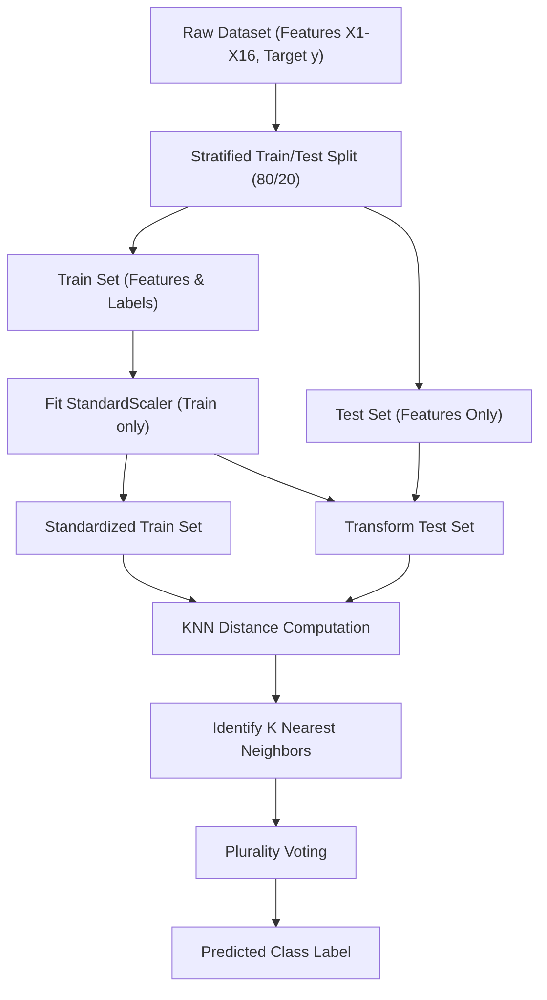
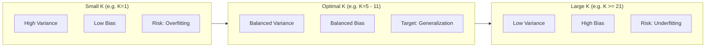

# Project Methodology: K-Nearest Neighbors Classification

> **Context**: Theoretical foundation, mathematical formulas, workflow mechanics, and best practices for the KNN model used on the BEED dataset.

---

## 1. KNN Principles & Characteristics

K-Nearest Neighbors is an **instance-based (lazy learning)** non-parametric algorithm:
- **No Training Phase**: The training phase purely involves indexing training points. Heavy computational loads happen at inference/prediction time.
- **Similarity-Based Prediction**: Unseen points are classified by majority voting among their $K$ closest neighbors in feature space.

---

## 2. Distance Computation & Geometry

Standard Euclidean distance in $\mathbb{R}^{16}$:

$$d(\mathbf{p}, \mathbf{q}) = \sqrt{\sum_{i=1}^{16} (p_i - q_i)^2}$$

Because Euclidean distance is sensitive to differences in feature magnitude, **Z-score feature standardization** ($z = \frac{x - \mu}{\sigma}$) is strictly mandatory.

---

## 3. Hyperparameter Dynamics: The Role of $K$

| Value of $K$ | Model Complexity | Decision Boundary | Primary Risk |
|---|---|---|---|
| **Small ($K=1, 3$)** | High complexity | Highly irregular, flexible | Overfitting (sensitive to outliers and noise) |
| **Moderate ($K=5, 7, 9, 11$)** | Balanced | Smooth, localized | Well-balanced trade-off |
| **Large ($K \ge 15, 21$)** | Low complexity | Oversmoothed | Underfitting (ignores localized class boundaries) |

