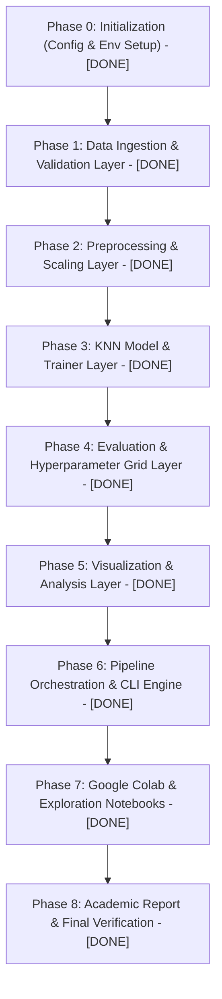
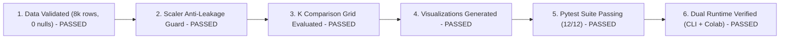

# Project Roadmap & Implementation Plan

> **Scope**: Phased engineering roadmap, delivery milestones, and quality gates for the BEED KNN Classification project.  
> **Status**: Completed (v1.0.0 Initial Baseline Release)

---

## 1. Development Phases & Lifecycle

---

## 2. Phase Breakdown & Tasks

### Phase 0: Initialization
- [x] Create root configuration: `config/config.yaml`
- [x] Freeze dependencies: `requirements.txt`
- [x] Create directory trees: `src/`, `notebooks/`, `tests/`, `outputs/`

### Phase 1: Data Layer
- [x] `src/data/loader.py`: `load_beed_dataset(path)`
- [x] `src/data/validator.py`: verify schema, 8,000 instances, no nulls, 4 balanced classes
- [x] `src/data/splitter.py`: stratified split (80/20) using `random_state=42`
- [x] Unit tests: `tests/test_data.py`

### Phase 2: Preprocessing Layer
- [x] `src/preprocessing/scaler.py`: strict anti-leakage `StandardScaler` wrapper
- [x] Unit tests: `tests/test_scaler.py` (verify $\mu \approx 0, \sigma \approx 1$ on train and anti-leakage isolation)

### Phase 3: Model Layer
- [x] `src/models/knn.py`: KNN estimator encapsulation
- [x] `src/models/trainer.py`: train-and-predict iteration across $K$ values

### Phase 4: Evaluation Layer
- [x] `src/evaluation/metrics.py`: multiclass accuracy, macro-precision, macro-recall, macro-F1, confusion matrix
- [x] `src/evaluation/comparator.py`: comparison aggregator exporting to CSV
- [x] Unit tests: `tests/test_pipeline.py` testing metric accuracy and model shapes

### Phase 5: Visualization Layer
- [x] `src/visualization/eda.py`: class balance, feature distribution, correlation heatmap
- [x] `src/visualization/results.py`: accuracy vs $K$, confusion matrix heatmap

### Phase 6: Orchestration Layer
- [x] `src/pipeline.py`: programmatic pipeline execution
- [x] `main.py`: CLI execution with argparse (`--config`)
- [x] Logging utility: `src/utils/logger.py`

### Phase 7: Interactive Notebooks
- [x] `notebooks/01_exploration.ipynb`: comprehensive EDA
- [x] `notebooks/02_knn_experiment.ipynb`: interactive pipeline runner with inline charts (Colab compatible)

### Phase 8: Final Academic Report & Verification
- [x] Populate `docs/REPORT.md` with final numbers, figures, and analytical insights
- [x] Update `CHANGELOG.md`
- [x] Complete Definition of Done checklist

---

## 3. Quality Gates (Definition of Done)

